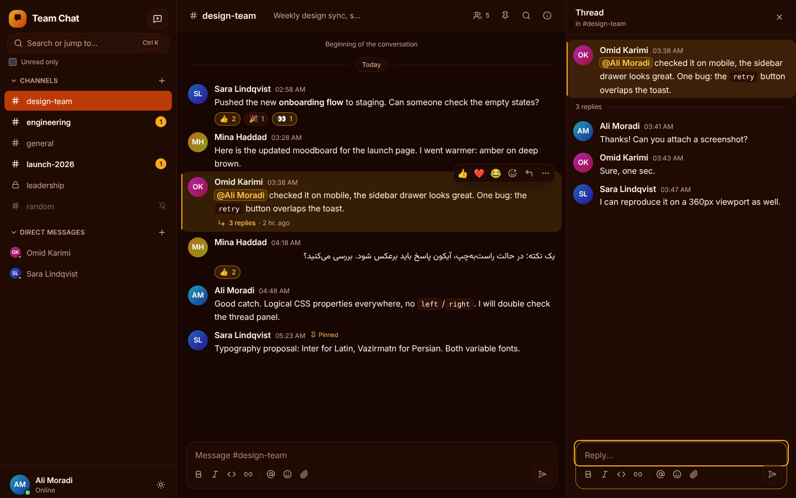
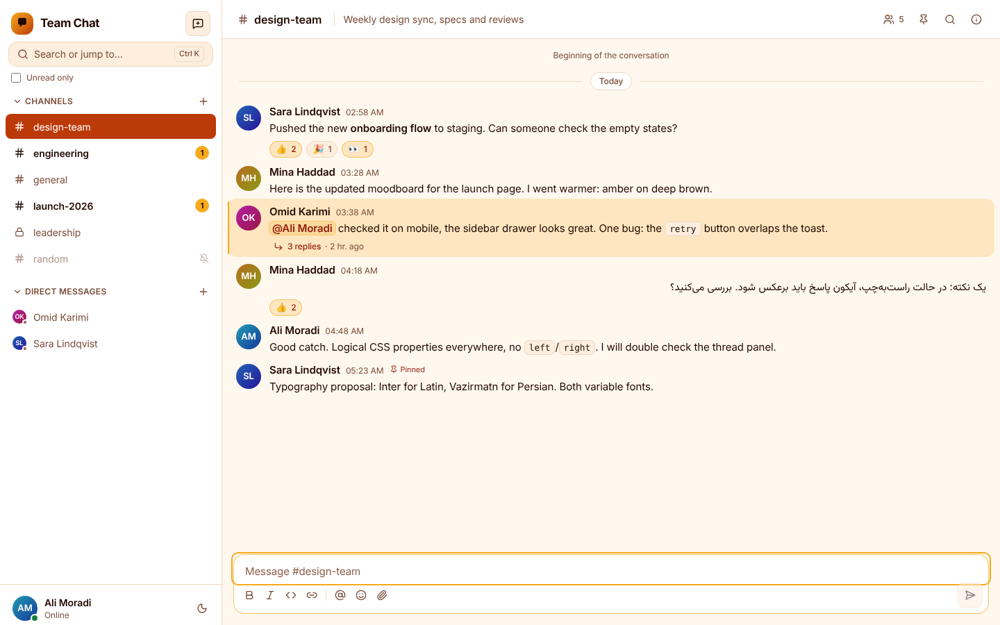
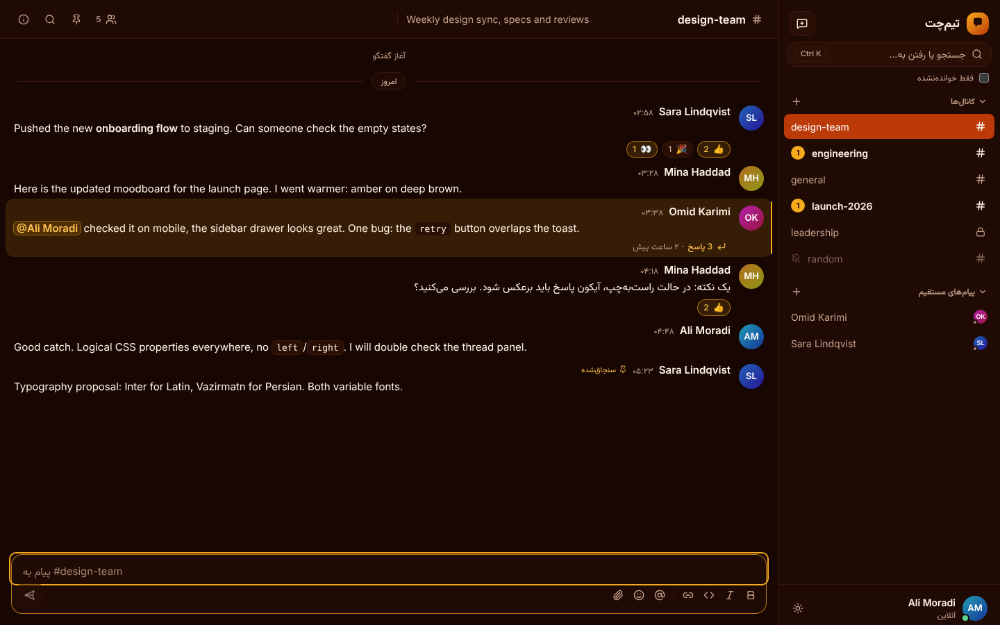
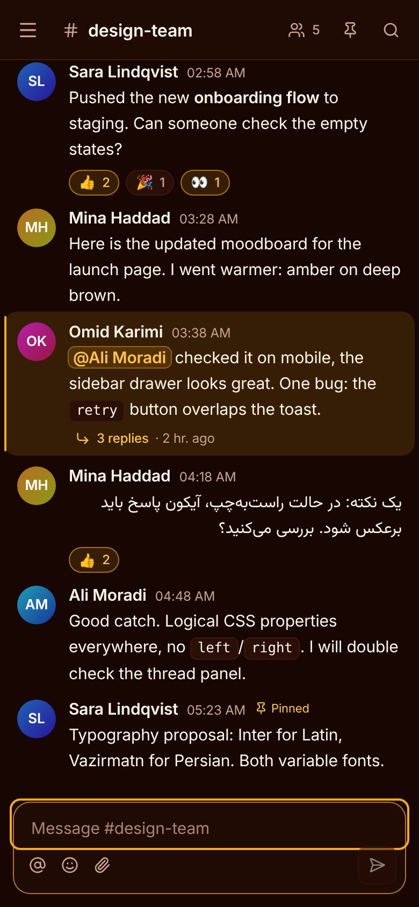
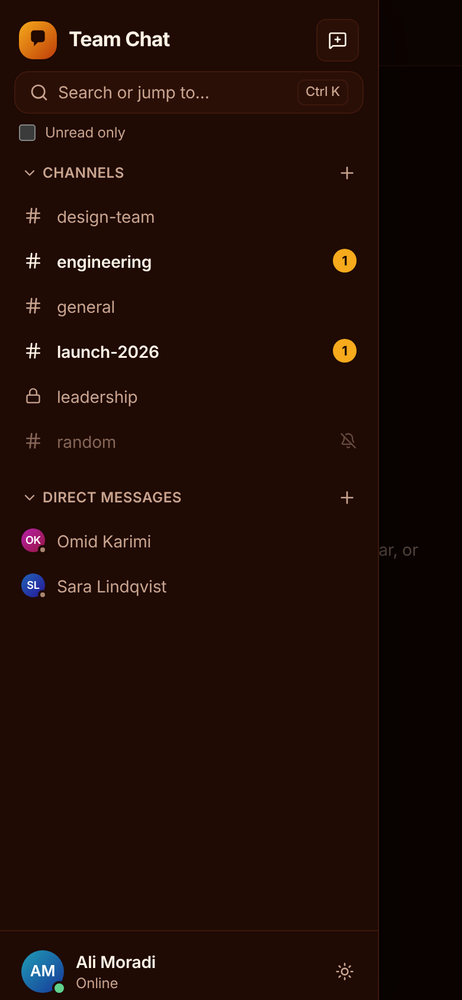

# Team Chat

A Slack-style team chat built with **Node.js, Express 5, Socket.IO and MongoDB** on the back end and
**React 19, Vite and Tailwind v4** on the front end. Channels and direct messages, threads, reactions,
mentions, files, read receipts, live presence, full-text search — in English and Persian (RTL), dark and light.

|                                           |                                           |
| ----------------------------------------- | ----------------------------------------- |
|  |      |
|       |      |

<p>
  
  
</p>

> The code started as a plain copy (without history) of two earlier practice repos by the same author:
> [`nodejs-chat-socket`](https://github.com/ali-moradi-design/nodejs-chat-socket) and
> [`nodejs-chat-web`](https://github.com/ali-moradi-design/nodejs-chat-web). Persistence, auth and most of the UI
> were rewritten; the socket handling ideas (ACK + `clientMsgId` dedupe, resync after reconnect, Zod on every payload,
> rate limits) and the Feature-Sliced Design layout carried over.

## Features

- **Accounts** — email + password (argon2id), JWT access token + rotating refresh token in an `httpOnly` cookie, the
  Socket.IO handshake uses the same session. One-click demo accounts.
- **Conversations** — public/private channels, 1:1 and group DMs, topics, invite/remove/leave, per-channel mute.
- **Messages** — light formatting (bold, italic, strike, code, code blocks, links), `@mentions` and `@channel`,
  edit (with “edited” label), soft delete, replies in threads, emoji reactions, pinned messages.
- **Files** — drag & drop / paste / picker, upload progress, type + size limits, magic-byte checks, EXIF stripping,
  image thumbnails (WebP), lightbox, access limited to conversation members.
- **Real time** — optimistic send with ACK and retry, `clientMsgId` dedupe, typing indicators, presence
  (online/away/offline, multi-tab aware), read receipts (“seen” in DMs), unread + mention badges, “new messages”
  divider, jump to latest, resync after reconnect, browser notifications and tab-title counter.
- **Search** — MongoDB text index, filter by channel and author.
- **Mixed languages** — every message has `dir="auto"`, so Persian and English lines each get the right direction.
- **UI** — dark-first (`#220901 · #621708 · #941b0c · #bc3908 · #f6aa1c` palette), light theme, fully responsive
  (320 px → 4K), keyboard shortcuts (`Ctrl+K` quick switcher, `?` for the list), accessible dialogs and menus.
- **Demo mode** — a bot that posts and answers, data reset every night.

## Quick start

Requirements: Node 22, pnpm 10, Docker (for MongoDB).

```bash
pnpm install
pnpm db:up            # MongoDB in Docker (docker compose up -d mongo)
cp apps/server/.env.example apps/server/.env   # optional, defaults work for local dev
pnpm seed             # demo workspace: ali@demo.dev / sara@demo.dev, password demo-pass-1234
pnpm dev              # API on :3001, web on http://localhost:5173
```

Production-like run in one container (API + built web app):

```bash
JWT_SECRET=$(openssl rand -hex 32) DEMO_MODE=true docker compose --profile app up --build
# → http://localhost:3001   (add --profile scale and REDIS_URL for the Socket.IO Redis adapter)
```

## Repository layout

```
apps/
  server/            Express 5 + Socket.IO + Mongoose  (modular monolith, see below)
  web/               Vite + React 19, Feature-Sliced Design, Tailwind v4, TanStack Query/Virtual, Zustand
packages/
  shared/            Zod schemas, typed Socket.IO events, rich-text parser — one source of truth for both apps
docs/                brief, architecture, deploy notes, performance notes, mockups, screenshots
```

### Server architecture

Modular monolith. Each module has four layers and may only depend inward:

```
modules/<name>/
  domain/          pure rules (no Mongoose, no Express)
  application/     services / use cases; depend on repository *interfaces*
  infrastructure/  Mongoose models + repository implementations
  presentation/    REST routes (Socket.IO handlers live in src/socket)
  index.ts         the only public entry of the module
```

`scripts/check-modules.mjs` enforces the layering and the “only through `index.ts`” rule in CI.
Modules talk to the realtime layer through a typed in-process **event bus** (`message.created`, `read.updated`, …),
so services never import Socket.IO. Every socket event is validated with Zod, rate limited per socket, and checked
against room membership (rooms mirror conversation membership, so authorization is O(1) per event).

### Web architecture

Feature-Sliced Design (`app → pages → widgets → features → entities → shared`), enforced by `scripts/check-fsd.mjs`.
REST data (users, search, pins, thread fetches) lives in TanStack Query; the live message timeline lives in a
normalized Zustand store that socket events update directly. The timeline is virtualized
(`@tanstack/react-virtual`) and keeps its scroll position when older pages are prepended.

More detail: [`docs/architecture.md`](docs/architecture.md), [`docs/performance.md`](docs/performance.md),
[`docs/deploy.md`](docs/deploy.md), [`SECURITY.md`](SECURITY.md).

## Scripts

| Command                | What it does                                                       |
| ---------------------- | ------------------------------------------------------------------ |
| `pnpm dev`             | API + web in watch mode                                            |
| `pnpm build`           | production builds (server bundle, web assets)                      |
| `pnpm lint` / `format` | ESLint / Prettier                                                  |
| `pnpm typecheck`       | TypeScript (strict) across all packages                            |
| `pnpm test`            | Vitest: unit + server integration tests against a real MongoDB     |
| `pnpm check`           | architecture rules (FSD + server modules) and the bundle budget    |
| `pnpm e2e`             | Playwright: two users chatting live, responsive matrix, 2,500-message history |
| `pnpm seed`            | reset the database and create the demo workspace                   |

## Testing

- **Unit** — rate limiter, sanitizers, domain rules, rich-text parser, list/merge helpers, stores, i18n key parity.
- **Server integration** — a real server and MongoDB, `socket.io-client` as the second user: auth + refresh rotation,
  history cursors, dedupe, threads, reactions, permissions, unread/mention counters, read receipts, search scoping,
  presence, uploads and access control.
- **E2E (Playwright)** — two browser contexts chatting in real time; a responsive matrix (8 widths × dark/light ×
  EN/FA) asserting no horizontal overflow and a visible composer; a 2,500-message channel checking DOM size and scroll
  anchoring.

## License

MIT
